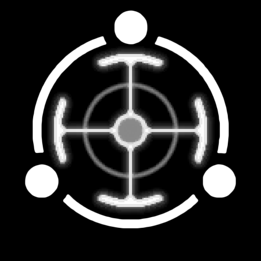

<div align="center">
  
  <h1>BZ_ODF_SHAMAN</h1>
  <p><strong>Visual ODF authoring, simulation & validation laboratory</strong></p>
  <p>Explore, edit and test Battlezone: Combat Commander object definitions.</p>

  
  
  
  

  <p><a href="#quick-start">Quick start</a> · <a href="#workspace">Workspace</a> · <a href="#development-status">Status</a> · <a href="docs/PROJECT_DETAILS.md">Technical guide</a></p>
</div>

## Overview

An integrated editor for Battlezone: Combat Commander ODFs, resources and effects. Inspect inherited values, experiment with combat parameters, preview effects and stage changes without modifying the original game files.

## Workspace

| Module | Purpose |
|---|---|
| **ODF Inspector** | Source-aware editing, inheritance, typed controls, raw text and undo/redo. |
| **Resource Explorer** | Search game and Workshop assets, inspect dependencies, conflicts and missing references. |
| **Weapons Lab** | Interactive 3D combat sandbox, weapon and ordnance chains, telemetry and parameter sweeps. |
| **Particle Lab** | Editable effect graphs, texture browsing, emitter presets and live previews. |
| **Audio Lab** | Resolve, inspect and play referenced WAV assets. |
| **Mod Profiles** | Persistent package priorities and explicit conflict resolution. |
| **Native Testing** | Staged launch eligibility, resource-closure checks and session tracking. |

## Quick start

From the repository root on Windows:

```bat
run.cmd
```

The project uses Godot 4.7.2 in its documented development environment. On startup it indexes available base-game and Workshop resources. Keep original game assets available locally.

## Development status

**v0.0.1 — early development.** The project has working editor and simulation modules, but editor previews must not be confused with native BZCC behavior.

- Lossless ODF round-trip, dependency resolution and staged export are documented and tested.
- The Weapons Lab and Particle Lab provide editor-side simulation, not a replacement for the game engine.
- Native launch staging is implemented; live native comparison remained unverified in the documented test session because Steam was not logged in.
- Original game/Workshop files are read-only by default. Edits live in the workspace until an explicit export or confirmed overwrite.

See [native testing](docs/NATIVE_TESTING.md), [preview fidelity](docs/PREVIEW_FIDELITY.md) and [known limitations](docs/KNOWN_LIMITATIONS.md) for the precise verification boundaries.

## Documentation

| Guide | Contents |
|---|---|
| [Technical guide](docs/PROJECT_DETAILS.md) | Detailed features, reference scenario, commands and recorded test evidence. |
| [Architecture](docs/ARCHITECTURE.md) | Subsystems and data flow. |
| [ODF compatibility](docs/ODF_COMPATIBILITY.md) | Parser and serializer coverage. |
| [Resource resolution](docs/RESOURCE_RESOLUTION.md) | Asset lookup and conflicts. |
| [Particle graph](docs/PARTICLE_GRAPH.md) | Effect graph and preview mapping. |
| [Testing & evidence](docs/TESTING.md) · [Evidence](docs/EVIDENCE.md) | Test inventory and results. |
| [Wintage themes](docs/WINTAGE_THEMES.md) | Theme system. |

Run the project tests from the repository root with `tools\run_tests.cmd`. See [CHANGELOG.md](CHANGELOG.md) for changes.

## Battlezone toolkit

[Map editor — BZ_MAP_MAG](https://github.com/vacterro/BZ_MAP_MAG) · [Model converter — bzconv](https://github.com/vacterro/BZ_XSI_MSH_FBX_CONVERTER) · [Project index](https://github.com/vacterro)

<div align="center"><sub>Edit the data. Test the behavior. Keep the evidence.</sub></div>
